# EgoTouch · 实验部署图文调研

[返回项目首页](../README.md) · [完整论文清单](paper_inventory.md) · [相机比较](camera_setup.md) · [触觉与标定](tactile_sensing.md) · [RealSense](realsense.md) · [仿真](simulation.md)

 **整理日期：2026-09-19（Pacific）｜第一版：围绕实验部署的原文核读。** 

起点是项目提供的《EgoTac (1).pptx》6 页论文清单。按“学长希望看到具体怎么做实验”的要求，提取参与者、左右手、穿戴、相机、动作、重复次数、标签来源、标定与同步，并配原文装置图。PPT 中 24 项研究工作全部列入清单：23 项取得论文全文，EgoH4RT 核对项目页；另补充 EgoTactile，解释裸手与戴手套同步采集的例子。MANO / SMPL 单列为基础工具。

 **读图约定：**  所有页码都是本次下载文件的  **PDF 页码，从 1 开始** ，不是期刊印刷页码。图片是原论文局部截图，版权归原作者；图下给出原文链接。本文中文为整理者概括。“未找到”指本次核读的正文及附录未找到，不代表设备没有该能力。“建议”是 EgoTouch 的待讨论方案，没有被当作已完成实验。

## 1. 先回答：戴手套与裸手，到底是什么关系？

| 容易混淆的说法 | 实际部署 | 能提供什么标签 | 本次对应论文 |
| --- | --- | --- | --- |
| 戴手套操作 | 画面中的同一只手穿传感手套，视频与传感器一起记录 | 该手的直接测量；仍有同步、标定、映射误差 | TouchAnything、EgoTac、EgoTactile gloved |
| 裸手操作，另一只戴手套的手模仿 | 裸手在画面内；戴手套的手在画面外同步抓握 | 近似、弱配对的代理标签，不是裸手直接测力 |  **EgoTactile bare-hand** （补充论文） |
| 裸手接触传感表面 | 传感器在桌面压力板或物体里 | 接触表面的直接/标定后测量 | EgoPressure、PressureVision、EgoPHI |
| 同一轨迹重放并比较控制器 | 人先示范；机器人执行同一参考轨迹，比较有无力反馈修正 | 机器人执行时的力与参考力误差 |  **REFORCE**  |
| 去掉视觉或触觉输入 | 固定任务和评估条件，比较不同观测模态 | 模态消融结果，不等于换人或摘手套 | DEX-X、VT-MUSE |

因此，当前应使用“对照实验 / 模态消融 / 弱配对采集 / 轨迹重放”等准确名称，不能把这些流程统称为“对抗实验”。EgoTactile 原文写的是“另一只手”，并未明确要求“两名参与者”；图中也不宜据此猜测操作者身份。

## 2. 最值得先看的装置

| 工作 | 相机与安装 | 手与触觉 | 实际执行方式 | 最有参考价值的部分 |
| --- | --- | --- | --- | --- |
| TouchAnything | 头戴 RGB + 左右腕鱼眼；640×480，30 Hz | 双手；内层 Rokoko，外层 JQ 触觉手套；Vive | 自然双手操作 | 多视角与多流采集组织 |
| EgoTac | 头戴 ZED 2i RGB-D；1080p，30 FPS | 双手；每手 132 个保留力通道 + IMU + Vive | 自然操作后离线对齐 | 传感器到 MANO 的映射 |
| EgoTactile（补充） | DJI Action 5 Pro；头戴/颈戴；720p30 | 162 传感点手套，约17 Hz | 同手配对 / 画外手弱配对 | 裸手迁移与重复验证 |
| EgoPressure | 7 台固定 + 1 台头戴 Azure Kinect；30 FPS | 裸手左右分开；Sensel Morph | 31 种手势，3/5 次重复 | 标定、硬件触发、标准操作指令 |
| EgoPHI | 头戴 C920 + 物体下方鱼眼；30 FPS | 裸手；发光亚克力物体 | 左 / 右 / 双手，约10次/手势 | 不戴手套的物体端接触测量 |
| REFORCE | ACT 示范采集用 RealSense L515 + 腕部 AprilTag | Manus + 五指 FSR；机器人 XHand | 人示范 → 机器人重放/反馈修正 | 轨迹相同，力反馈不同的对照 |
| DEX-X | 固定 RealSense 深度相机；型号未找到 | FR3 + Sharpa Wave 指尖触觉 | 仿真训练 → 真机闭环执行 | 视觉/触觉消融，每项30次 |

下文是这些结论的原文依据及完整部署记录。

## 3. 人手视频与触觉：重点实验卡

### 3.1 TouchAnything — 双层手套、头戴与双腕相机

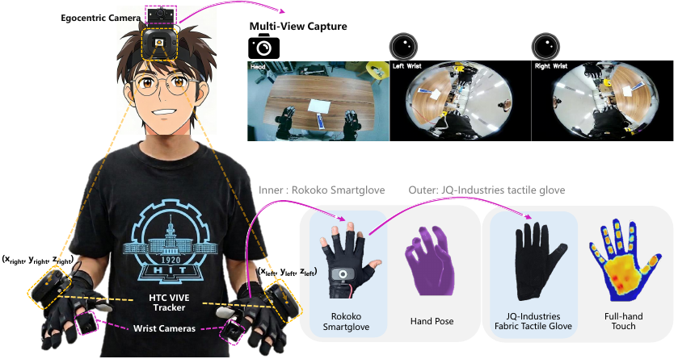

原图：Figure 2，PDF p.4；[论文](https://arxiv.org/abs/2605.13083)，装置与数据见 §2、Appendix B（pp.15–16）。 **命名提醒：这篇论文的数据集也叫 EgoTouch；它与本仓库项目不是同一个项目。** 

-  **怎么穿、怎么装：**  双手内层为 Rokoko Smartgloves，外层为 JQ-Industries fabric tactile gloves；腕部配 HTC Vive tracker 和鱼眼相机。主文/图2展示头戴视角，外加左右腕视角。附录使用 chest/head 表述并出现 chest.mp4 文件名，因此具体采集批次是否包含胸戴，仍需向作者确认。
-  **记录什么：**  三个 RGB 视角均 640×480、30 Hz；双手42个关节点；每手16×16原始触觉网格，训练时重新排布成21×21手形图。序列包含 tracker 位姿、对象/任务元数据。
-  **怎么做动作：**  自然双手操作，覆盖家庭、工作台等208个任务；报告1,891段、约20小时、2.1M帧、超过1,000个物体。不要把总帧数误当独立重复次数；统一“每人×每物体×每动作”的重复表在本次核读中未找到。
-  **同步与标定：**  相机、手套、位姿各自采集线程；统一30 Hz保存循环读取各流最近有效样本，记录 frame_index 与时间戳。Rokoko→Vive 可用标定矩阵时进行坐标对齐；相机内参可用时保存。 **这是软件取最新样本，不等同硬件同时曝光。** 
-  **对照与限制：**  比较 ego-only 与加入一个/两个腕视角；手套外观和自然裸手存在差异。未见裸手与画外手逐次配对采集方案。相机具体型号、原始触觉频率、同步误差分布未找到。
-  **对 EgoTouch 的启发：**  可借用逐流保存及统一索引；先确保一个头戴视角覆盖接触区域，再决定是否加腕视角。原始时间戳应保留，不能只保存已对齐帧。

### 3.2 EgoTac — ZED 2i 与双手力/姿态采集

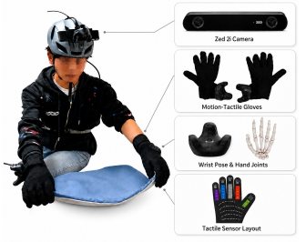

原图：Figure X1，PDF p.14；[论文](https://arxiv.org/abs/2608.15060)，§3.3 p.4、Appendix B pp.14–15。

-  **硬件：**  头戴 ZED 2i RGB-D，相机1080p；主文明确30 FPS，可选导出点云。每手 HTC Vive Tracker + 自制运动触觉手套，11个九轴惯性模块；手姿态包含20关节及腕位姿。
-  **触觉布局：**  正文双手共264力传感器；附录明确每手保留60个手指力通道、72个掌部力通道，共132个，排除5个弯曲相关通道。不能把778个 MANO 顶点当作778个真实传感器。
-  **采集流程：**  连接相机、穿戴设备和采集终端 → 启动传输/采集软件 → 姿态标定 → 完成指定操作任务 → 在界面结束序列 → 保存原始数据并离线同步。任务包括叠衣、擦桌、开门等，超过70项，24种环境。
-  **规模与重复：**  自采 EgoTac-SC 为3.9M帧、857段（Table 1）；5.7M是混合多个数据集后的规模，不是全部重新实测。参与者总数、统一每任务重复次数本次未找到。
-  **同步/标签：**  各流独立时间戳，重采样到共同时间轴；刚体姿态采用适合 SE(3) 的插值，力值线性插值；固定变换链统一坐标。132通道按预定义区域和权重映射到每手778顶点，0.05 N阈值生成接触标签。插值后的密集顶点不是独立力测量。
-  **裸手怎么处理：**  混入裸手 HOI 数据的几何接触标签；附录讨论手套改肤色未明显改善迁移。它与 EgoTactile 的画外手弱配对是不同路线。传感器原始采样率、逐通道绝对力标定曲线、残余时差仍待补查。

### 3.3 EgoTactile — 最接近“裸手 + 画外手套模仿”的例子

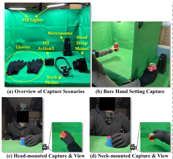

原图：Figure 2(a–d)，PDF p.5；[论文](https://arxiv.org/abs/2606.09243)，§4.1 p.4、Appendix A.1 p.12、E.1 p.19。 **这是针对用户举例补充核查的论文，未在 PPT 清单中直接列出。** 

-  **摆在哪里：**  绿幕和补光环境，跨 session 改变照明与物体姿态；DJI Action 5 Pro，1280×720、30 FPS；同时研究头带与颈戴安装。触觉手套162点，原文量程以0–350 N表示，约17 Hz。
-  **直接配对：**  抓物体的手戴手套并出现在视频中；相机与这只手的触觉配对。
-  **裸手弱配对：**  视频中是裸手，画外另一只戴手套的手同步抓握，提供代理标签。节拍器控制“接近—接触—抓握/保持—释放—撤回”，同一参与者对不同物体采用不同节拍，避免模型只记固定时间模式。 **同步动作不保证两只手施加相同力。** 
-  **参与者/次数：**  12人，均右手优势；63个物体、7类。附录一般抓握协议要求优势手、每人每物体5次，每次约6秒；每录制15分钟休息5分钟。总采集表与训练/测试子集口径分开，不能直接用12×63×5推算最终有效片段。
-  **同步怎么做：**  相机30 Hz、手套约17 Hz，主线程15 Hz取最新视频帧和缓存中的最新触觉样本；视频丢弃旧帧，触觉 sample-and-hold，最终发布/评估在15 Hz时间轴上。这与两只手“动作一致性”是两种不同误差。
-  **是否验证过模仿可靠性：**  双手都戴手套做验证：3人×5个留出物体×10次，150段。原文报告接触开始/释放平均差105/118 ms，接触 IoU 82.7%；另有1人×3物体×30次的跨次重复验证。上述数值衡量该协议下的一致性，不能当作我们设备的同步精度。
-  **仍缺什么：**  手套具体商用型号和完整绝对力校准流程本次未找到。N是力单位；没有有效感应面积不能擅自转换成kPa。
-  **对 EgoTouch 的启发：**  第一阶段先采“同手视频+指套”直接配对；裸手代理标签单独标识并先验证一致性，不能混入直接测量作为无误差真值。

### 3.4 EgoPressure — 裸手、多相机与桌面压力板

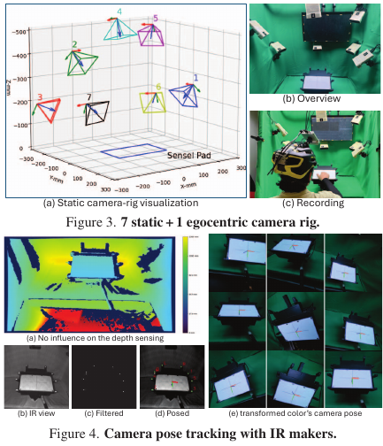

原图：Figures 3–4，PDF p.4；[CVPR 2025 原文](https://openaccess.thecvf.com/content/CVPR2025/papers/Zhao_EgoPressure_A_Dataset_for_Hand_Pressure_and_Pose_Estimation_in_CVPR_2025_paper.pdf)，§4 pp.4–6。

-  **装置：**  7台 Azure Kinect 固定在铝框上，1台固定在头盔上朝向桌面；参与者坐可调高度凳。Sensel Morph（240×169.5 mm）固定在云台上；四种纸质纹理覆盖层，绿幕、显示器和漫射照明。手是裸露的，黑袖套只到腕部。
-  **图像：**  静态相机RGB为2560×1440，头戴为1920×1080，采集30 FPS；深度也采集。相机可采RGB-D与最终模型只输入RGB是两回事。
-  **同步：**  两台工作站连接设备；Raspberry Pi CM4 通过 PTP 对齐时钟并同时触发 Kinect。压力板周围9个非对称主动IR标记，由CM4控制；红外图像检测后以PnP恢复头戴相机位姿，也用于检查时间同步。主文未给出最终时差分布，不能只凭“PTP”推断零延迟。
-  **动作与次数：**  21人；左右手分别做31种触碰、按压、拖动等手势。单次接触动作重复5次，连续触碰序列重复3次；录制前展示示范视频与文字。每人约1小时。原文总计6,216次手势执行，含左右手标定。
-  **标定与GT：**  每只手先张开手指缓慢旋转，估计固定 MANO shape；多静态视角经 HaMeR/SAM 与优化得到手姿态/网格。Sensel实测平面法向压力，投影到手网格；0.5 kPa最低有效阈值。姿态是多视图优化标签，不是传感器直接给出的真实关节角。
-  **对照：**  RGB vs RGB+预测姿态 vs RGB+GT姿态；ego/exo/新视角；15人训练验证、6人测试。它不覆盖任意三维物体的全表面触觉，且七相机框架复制成本较高。

### 3.5 PressureVision — 受控的裸手平面压力采集

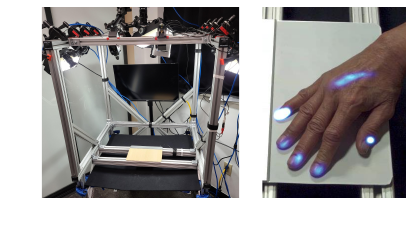

原图：Figure 3(a–b) 局部，PDF p.6；[论文](https://arxiv.org/abs/2203.10385)，§3 pp.6–7。

四台已标定、同步的 OptiTrack Prime Color 从上方拍摄1080p RGB，安装在刚性框架上；三盏 eStrobe 可组合8种照明。Sensel Morph架高，手可伸到下方完成边缘捏握；输出185×105压力图，间距1.25 mm。主要用白色覆盖层，7名参与者用木纹层；只测该平面的法向压力，最低有效阈值0.5 kPa。

36人先一只手再另一只手做36种动作，包含指按、整手压、切向用力、抓边缘、画线；部分动作提示高力、低力或不接触。报告16小时互动、四相机合计64小时RGB。每动作统一重复次数、相机FPS和同步实现细节在上述采集章节未找到。可借鉴“高/低/无接触”指令和固定光照对照，但这不是头戴实验。

### 3.6 PressureVision++ — 有压力真值与弱接触标签分开采

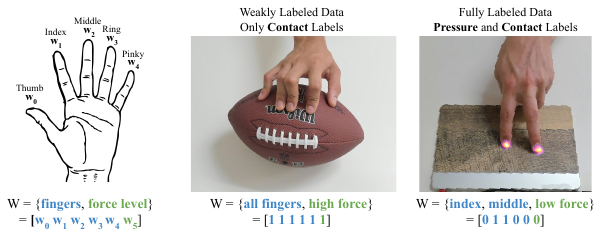

原图：Figure 3局部，PDF p.4；[WACV 2024 原文](https://openaccess.thecvf.com/content/WACV2024/papers/Grady_PressureVision_Estimating_Fingertip_Pressure_From_Diverse_RGB_Images_WACV_2024_paper.pdf)，§3 pp.3–4。

51人、20种环境、106种物体/表面；多个消费级webcam，1080p30；相机具体型号和头戴方式未报告，不能据此画成头戴系统。只研究指尖接触。参与者按指令组合8种指尖配置与高/低力、滑动、悬停条件。传感板序列反复按下与抬起；无压力传感器的自然物体序列要求全程维持指定接触。

完整标签来自 Sensel Morph；自然物体只有“哪些指接触/提示的力度级别”的弱标签，并没有连续压力实测。总2.9M帧中0.5M完整标签、2.4M弱标签；37人训练、14人测试。压力图经单应性变换投影到RGB。统一重复数、时间同步误差未找到。 **这是提示驱动的弱标签，不是画外戴手套模仿。** 

### 3.7 Touch and Go — 两个人协作，手持 GelSight 逐个探测

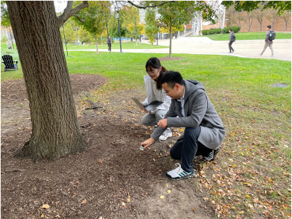

原图：Figure 6，PDF p.17；[论文](https://arxiv.org/abs/2211.12498)，§3.1 pp.3–4，补充材料 p.17。

一人用手持 GelSight 接触物体，另一人用普通webcam拍摄接近第一视角的手部画面； **明确是两人，但不是头戴相机，也不是第二人模仿轨迹。**  作者在室内外连续走动，依次触碰物体，每件约3次、每次按压平均0.7秒；多材料物体分别触碰不同区域。

GelSight为约1.5 cm曲面凝胶、彩色照明与嵌入标记；记录形变的触觉图像。两个视频均约27 Hz，同一电脑并行采集；没有额外力传感器。压力/剪切可由图像进一步估计，但数据不能直接叫作已校准的逐点牛顿力。具体webcam型号、时间误差、佩戴支架不适用或未报告。可借鉴低负担试采和材料覆盖，不能据此支持自然五指抓握研究。

### 3.8 EgoPHI — 裸手不装传感器，测物体上的接触

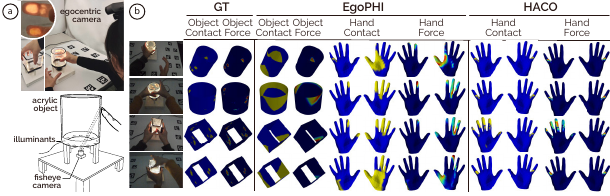

原图：Figure 6，PDF p.13；[论文](https://arxiv.org/abs/2608.13014)，真实验证装置 pp.12–13。

-  **装置：**  制作亚克力立方体和圆柱体，以照明/光学接触响应测接触；物体下方安装8MP Sony IMX179近180°鱼眼。参与者头戴 Logitech C920（78°对角FOV）；两相机固定曝光、30 FPS。不要将8MP传感器标称像素误当实际录制分辨率。
-  **流程：**  8人，对两物体完成不同位置/力度的两指抓握，三/四/五指抓握、整手抓握、单指按压；左、右、双手每手势约10次，session少于20分钟；报告约2,000对同步ego/接触力帧。
-  **几何标定：**  棋盘格标定鱼眼内参；物体缺乏纹理，因此贴 ArUco 恢复物体姿态。
-  **力标定：**  8 mm亚克力面板、LED与胶带，放在1 g分辨率 Beurer 秤上；先在1,000 g载荷调整曝光防饱和，再每50 g增加至1,000 g；每级取10帧接触区域平均亮度、排除边缘，重量换算N并建立亮度—力查找表。
-  **关键边界：**  真实装置只测得 **物体端**  接触与力；图中手部力图是预测。训练中还使用 ARCTIC 手/物体几何与 SOFA 仿真产生物理标签。同步误差和硬件触发方式本次未找到。
-  **可借鉴：**  把手套对自然动作的干扰转移到物体端，但需要制作特定物体，不能直接扩展到所有日用品。

### 3.9 HOPE 与 EgoPressDiff — 方法论文要追溯数据源

| 工作 | 硬件到底来自哪里 | 标签/对照与复现要点 | 未解决的部署问题 |
| --- | --- | --- | --- |
| [HOPE](https://arxiv.org/abs/2608.06192)（PDF pp.4–5,8） | OpenTouch 手套数据；PressureVisionDB 平面压力；ARCTIC/DexYCB 等接触数据 | OpenTouch的16×16掌侧taxel映射到778 MANO顶点；PVDB用相机—压力板几何投影；只有接触标签的样本不施加压力回归损失 | 不能把HOPE当作新装置；相机/手套参数应引用原数据集 |
| [EgoPressDiff](https://arxiv.org/abs/2606.06872)（PDF p.3 §3.1） | 直接复用 EgoPressure | 15人训练、6人测试；深度由  **Video Depth Anything**  生成，其他控制信号取已有标注；256×256是训练尺寸 | 不能将生成深度说成RealSense深度；没有新的穿戴采集协议 |

HOPE 的 OpenTouch 数据源值得下一轮深挖。[OpenTouch 项目页](https://opentouch-tactile.github.io/)说明使用 Meta Aria、Rokoko Smartgloves 与FPC触觉传感器，30 Hz同步，并报告平均2 ms延迟；该页面未在此说明2 ms的完整测试定义，因此目前不把它与其他系统的端到端误差作排名。这里是对 HOPE 数据源的补充追溯，不改变 PPT 的24项计数。

## 4. 人类示范到机器人：轨迹、触觉与对照

### 4.1 EgoScale — 对齐人的视角和机器人的视角

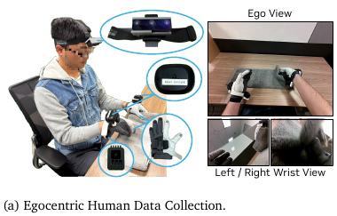

原图：Figure 2(a)，PDF p.4；[论文](https://arxiv.org/abs/2602.16710)，§2.1–2.2 pp.3–4。

大规模预训练来自ego视频及现成姿态/SLAM管线；精确对齐的中期训练集另行采集。后者一台头戴相机、两台腕相机，尽量与机器人匹配视角、标定内参；Vive测腕部位置与方向，Manus手套记录25个关节变换，动作与视频同步。 **这里Manus是姿态手套，不能自行加上“测触觉压力”。** 

中期数据344项桌面任务，每任务约30条人类轨迹、5条机器人遥操作轨迹，约50小时人类、4小时机器人。不是每条人类轨迹都存在一一对应机器人重放。相机具体型号、同步实施与残差、每轨迹的对象初始化范围未找到。对 EgoTouch 最实用的是先统一相机视角/坐标和任务范围，再谈人到机器人迁移。

### 4.2 REFORCE — 同一轨迹下比较“直接重放”与“力反馈修正”

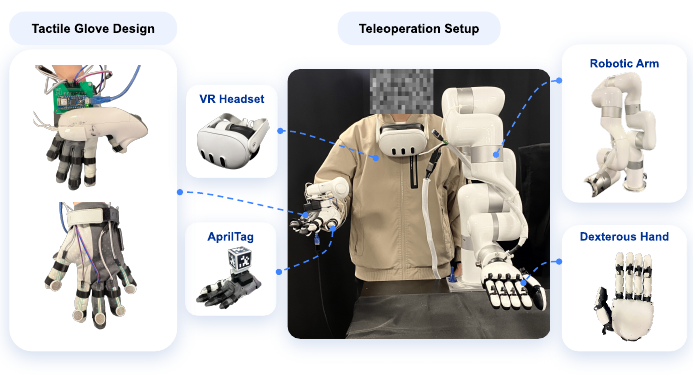

原图：Figure 3，PDF p.5；[论文](https://arxiv.org/abs/2608.15560)，§4.1 pp.5–7、Appendix A p.13。

-  **人端：**  Manus捕捉手姿态，五个指尖FSR提供参考力；遥操作用Quest控制器测腕位姿。用于训练ACT参考策略的数据采集，另用  **RealSense L515 + 手腕附近AprilTag**  追踪腕部。不是头戴L515方案。
-  **机器人端：**  UFACTORY xArm + 12 DoF XHand，机器手指尖触觉提供实时反馈。人端FSR和机器人传感器都标定到N，才比较参考与执行力；标定夹具/拟合细节本次未找到。
-  **任务与对照：**  纸杯侧抓/顶抓，同一录好的源轨迹给直接replay、admittance、REFORCE； **每配置5次真机试验** 。另一组以学到的动作/力参考完成纸杯和夹钳任务，同时评估完成、超力和失去接触，不能以“力更小”独立判成功。
-  **示范数量/频率：**  ACT每任务约30–40条人类示范，原始示范83 Hz，训练锚点10 Hz；这两个频率不能写成L515相机FPS。该组ACT输入是关节配置历史与阶段，不使用视觉；腕轨迹单独记录。
-  **要借鉴：**  这才是清晰的“参考轨迹一样、反馈机制不同”的对照范式。若我们先做人类采集，尚不需要复制整台机器人；先把姿态与指套力的物理单位、时间轴对齐。

### 4.3 DEX-X — 固定 RealSense + 指尖触觉的真机消融

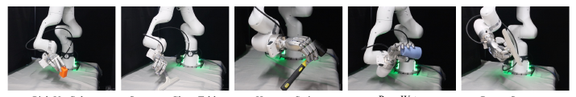

原图：Figure 3，PDF p.6（为真机任务示例， **不是完整相机安装图** ）；[论文](https://arxiv.org/abs/2609.07747)，§4 pp.6–7、Appendix B pp.13–14。

Franka FR3 + Sharpa Wave，单臂29 DoF/双臂58 DoF；固定RealSense深度相机和指尖触觉。具体RealSense型号、安装高度/夹角、深度分辨率和跨设备时差未找到。IsaacLab中4096并行环境训练，策略部署30 Hz；策略频率不等于相机采样率。

流程是人类视频重建手物轨迹 → 仿真优化和接触交互 → 状态teacher → 视觉触觉student → 真机闭环。student使用深度场景点云、手关键点和带力值的触觉点。真机cube picking各观测条件30次：完整视触觉28/30，无视觉14/30，无触觉11/30，仅本体状态8/30。报告其他真机任务各30次。可直接借鉴 **固定任务、明确试验次数、消融输入** ；不可写成“戴手套的人与裸手的人竞争”。

### 4.4 EgoEngine — 眼镜视角的人类示范、仿真与机器人

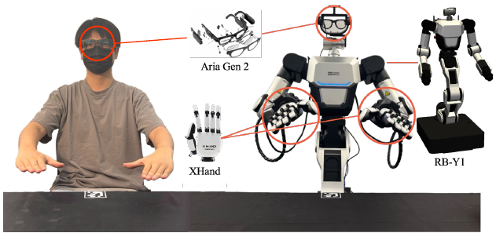

原图：Figure A.1，PDF p.14；[论文](https://arxiv.org/abs/2606.12604)，Appendix A pp.14–15。

本次论文PDF使用  **Aria Gen2**  录人类示范，并把同类眼镜刚性安装到机器人头部，以接近人视角。目标是RB-Y1 + XHand；仿真双臂双手，真机单臂单手。项目网页曾展示不同配置；这里按本次PDF记录，不把旧配置混写。

桌面AprilTag是公共坐标锚点：人眼镜→Tag→机器人基座；机器人头部运动通过正向运动学更新相机到基座变换。TACO来源用物体几何定义伪机器人基座，不能说也执行了相同真实标定。真实遥操作参考用SEW/Open-TeleVision，结合Meta Quest；它是用于对比的数据分支，不是人类源视频的触觉手套采集。没有物理触觉GT通道；相机录制规格及时间同步误差本次未找到。

### 4.5 FTP-1 — 机器人触觉跨传感器迁移

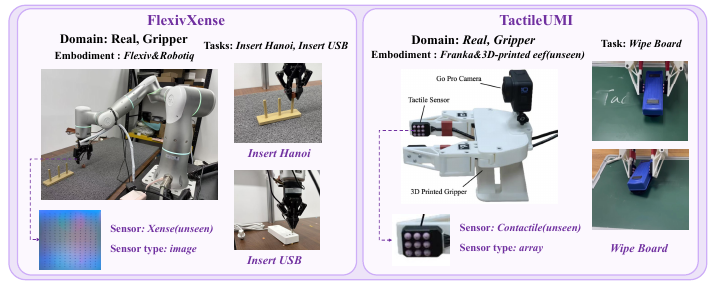

原图：Figure 6，PDF p.7；[论文](https://arxiv.org/abs/2606.13102)，§4.1、Appendix E / Table 5 p.20。

实验包含多个不同平台，不能合并成一个“相机+手套”装置。Flexiv + Robotiq + Xense图像触觉做插环与插USB，每任务100条微调示范；Franka + 3D打印末端 + Contactile阵列做擦板，50条示范。另有Sharpa North、Dexmate/Sharpa Wave和UniVTAC仿真平台。50/100是示范数量，不能充当评估重复次数。论文所列硬件表未充分交代每个平台相机型号、视场、同步标定；该工作适合参考不同触觉表示的接口，不能直接复制成指套人体采集协议。

### 4.6 VT-MUSE — 力反馈遥操作采集与固定真机测试次数

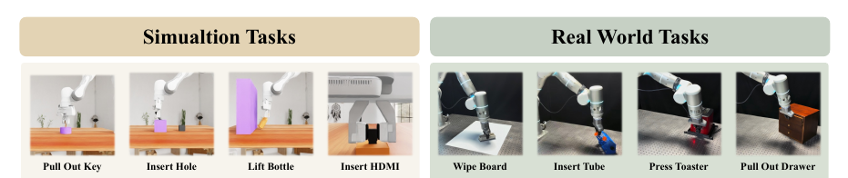

原图：Figure 3，PDF p.5；[论文](https://arxiv.org/abs/2608.21290)，§IV pp.4–5。

真机Flexiv Rizon 4s + XenseGripper，借助Flexiv RDK/TDK进行力反馈遥操作。插管、擦板、拉抽屉、按烤面包机四任务，每任务50条示范，共200条；每方法每任务20次评估，共享初始化与成功条件。视觉baseline只接外部RGB，视触觉baseline再加当前触觉，完整方法利用时序表示。摄像头具体型号、录制FPS、安装尺寸、时间同步误差未找到。

仿真另用UniVTAC四任务：表示学习每任务500轨迹，策略学习50示范，评估同样100个初始条件。必须把“仿真100次”与“真机20次”分开记录。

### 4.7 Facet-0 — 三相机、腕部六维力矩和装配任务

[论文](https://arxiv.org/abs/2609.01596)，§3 pp.4–5、Appendix A–B pp.19–20。

每个采集单元包括力矩控制机械臂、平行夹爪、腕部六轴F/T、3台RGB和关节状态；通过带力反馈的动觉遥操作采示范，并混入带人工干预的策略rollout。组装CPU、RAM、硬盘、GPU；标注接近、对齐、插入、按压、就位、紧固、退出阶段。

硬件时间戳共用时钟，15 Hz训练时间轴；高频状态/力保留供200 Hz控制器使用，时差超容限的episode丢弃，但该容限具体数值未找到。每个主表格单元20次，机箱姿态随机、自动供料，不重跑。相机品牌、安装位姿、相机原始FPS和具体同步容限仍需补充。腕部合力/力矩不等于指尖密集触觉；约1,000小时是论文报告语料规模，未在本项目独立复验。

## 5. 仿真与离线处理：不能当成真实采集装置

### 5.1 Tabero — 在 Isaac Sim / Isaac Lab 重放已有轨迹

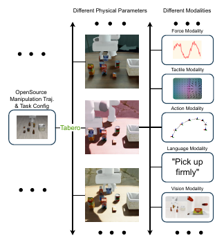

原图：Figure 2，PDF p.3；[论文](https://arxiv.org/abs/2605.27886)，§3.1–3.2 pp.3–4。

将原MuJoCo等来源的任务、物体初态和轨迹迁入Isaac环境；装上仿真触觉夹爪后，需重新对齐TCP，调整机械臂基座并用高增益PD关节控制重放，不能直接复制原OSC命令。同步渲染腕部/第三视角RGB-D；仿真GelSight为320×240、11×9标记网格，触觉图像使用Taxim。这里的“同步”是仿真时间上的对齐，不是解决真实USB设备的同步。建议借鉴轨迹回放后的成功筛选与多模态输出组织。

### 5.2 Tactile Genesis — 固定任务，改变传感器表示与覆盖位置

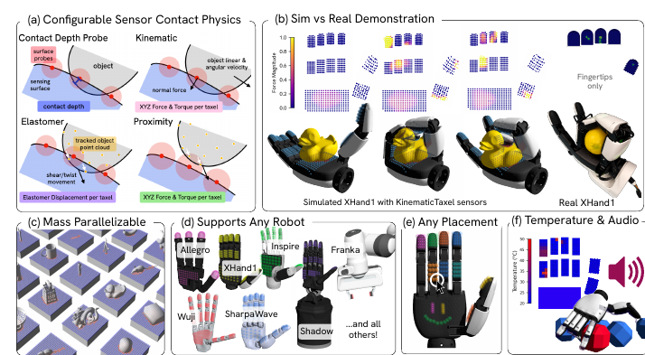

原图：Figure 1，PDF p.2；[论文](https://arxiv.org/abs/2606.22332)，§3–4 pp.4–7。

基于Genesis World，比较接触二值、深度、力/力矩、弹性体位移、接近等表示；在固定手、任务和策略配置下改变指尖/手指/整手覆盖和分辨率。任务包含掌内转动、手内重定位、螺丝刀旋转；先训练有物体状态的teacher，再蒸馏到触觉student，并加入噪声设置。适合回答“指套放在哪里更有用”，但本项目尚未实测验证，仿真里的整体覆盖收益不能直接作为我们指套配置的结论。

### 5.3 DexFlow — 几何重定向与仿真抓握验证

[论文](https://arxiv.org/abs/2505.01083)，§III–IV，PDF pp.3–6。

MANO轨迹映射到ShadowHand/Allegro，通过接触距离、穿透、法向与时序项优化；50个YCB物体、292k右手轨迹帧。Isaac Gym/PhysX中以位置控制施加抓持，在六个轴向重力条件下检验100步后是否保持接触。292k是帧数，不是292k条独立轨迹。这里的接触来自几何/仿真，并无人体触觉传感器、相机同步或实测力GT。

### 5.4 其余重建/生成工作：在采集链中的位置

| 工作与原文位置 | 真正输入和实验来源 | 如何用于 EgoTouch | 本次没有证据支持的说法 |
| --- | --- | --- | --- |
| [EgoHOI](https://arxiv.org/abs/2603.13615)，PDF p.23 Appendix C.1 | HOT3D-Clips；Project Aria forward RGB stream 214-1及已有相机、手、物体标注；整理为150帧、16 FPS clip，1364训练/152测试 | 视频生成、手物动态与视角变化的下游实验 | 16 FPS不是新硬件标称采样率；生成视频不是测得力 |
| [MINT](https://arxiv.org/abs/2609.04958)，PDF pp.4,7–8 | 单目ego视频估计相机与双手；第一阶段1021小时管线伪标签，第二阶段小型自采单rig相机轨迹 | 离线位姿标注候选，需检查世界尺度误差 | 本次未找到单rig型号和精确安装；不能声称它有触觉GT |
| [ACE-Ego-Hand](https://arxiv.org/abs/2608.20308)，PDF pp.5,13,20 | 复用ARCTIC/HOT3D等；81帧片段、离线视频上下文恢复遮挡手 | 检查手部可见性、离线姿态质量 | 处理吞吐FPS不是实时闭环延迟；遮挡下合理姿态不是绝对位置GT |
| [UMR](https://arxiv.org/abs/2609.02134)，PDF p.5 §IV | 几何点云对应与全身动作重定向；MuJoCo、Unitree G1评估 | 以后做全身/人形机器人迁移时参考 | 不是头戴相机或指套触觉采集论文 |
| [EgoH4RT](https://egoh4rt.pages.dev/)，项目页 | 页面标注paper/arXiv/code coming soon；展示HOT3D和Xperience头/手轨迹 | 记录为待论文公开；现有页面仅核查演示与评估来源 | 不能补写尚未公开的相机安装、传感器或同步协议 |

[MANO](https://mano.is.tue.mpg.de/) 与 [SMPL](https://smpl.is.tue.mpg.de/)是参数化人体/手部表示资源，不是触觉测量装置。顶点映射、网格距离接触、仿真力、传感器实测力必须分别标注。

## 6. 能立即用于本项目的三种候选方案

以下是 **建议，尚未实施** 。具体指套与RealSense型号未知，因此不填猜测规格。

| 方案 | 安装与流程 | 能验证什么 | 不能直接得到什么 |
| --- | --- | --- | --- |
| A · 轻量RGB试采 | 现有RGB相机固定在头带或眼镜支架；先桌面定点，拍完整手—物体交互 | 手部覆盖、遮挡、模糊、安装稳定性、任务指令是否清楚 | 连续触觉GT；姿态预测也不是直接GT |
| B · RGB-D试采 | 先把现有RealSense固定在桌面斜上方/前方；与A同任务，记录RGB和深度；再评估穿戴安装 | 近距离深度有效率、接触遮挡、坐标标定、USB/电源负担 | 深度不能直接测力；固定成功不保证头戴也成功 |
| C · RGB + 已有指套 | 头戴RGB、同一只操作手佩戴指套，记录原始视频/触觉/时间戳；再选是否加B | 接触开始/结束、可校准的力变化、视频—触觉对应 | 稀疏指套不覆盖掌面；没有面积和标定不能声称全手压力 |

 **建议先做C的小样本连通性试采，并保留A作为裸手外观参照；B先固定安装。**  裸手参照可比较遮挡和动作差异，但在没有额外物体端传感器时不把裸手力当直接GT。若希望走EgoTactile式弱配对，需要额外设备和一致性验证，作为第二阶段。

建议试采协议：一名操作者先用惯用手，3件易重复、几何不同的物体，每件5次；每次包含接近、接触、保持、释放、撤回。记录物体、手侧、安装、佩戴、session/trial、失败原因；若切换裸手/指套条件，交错安排顺序并保留各自标签来源。这是排查采集链的小试，不能当作泛化性能实验。

## 7. 下一轮必须补齐的工程信息

| 需要补齐 | 为什么影响方案 | 当前状态 |
| --- | --- | --- |
| 指套品牌/型号、通道布局、读数单位、SDK/串口协议 | 决定是接触、原始电阻还是已校准力；决定同步与布局 | 用户已获得硬件，具体规格待填 |
| RealSense具体型号、镜头/线缆/支架 | 决定近距深度、穿戴负担和同步功能 | 已有设备，型号待填 |
| 相机固定方式、工作距离和双手可见范围 | 文献通常不报告精确支架尺寸；需要我们实测 | 未实施 |
| 零点/加载卸载/漂移试验与参考力源 | 区分信号变化与可比较物理量 | 未实施 |
| 视频与触觉共同事件的时差、抖动、丢包率 | 相同FPS或统一保存循环不能证明采样同时 | 未实施 |
| 人体采集任务清单、左右手与参与者划分 | 决定重复性、标签范围和后续评估 | 本版提出小试建议，待讨论 |

本轮产出是有来源、可追溯的实验部署调查；没有在当前项目中完成任何硬件标定、采集或机器人实验。后续实测结果进入 Progress Log，不能覆盖原文记录。
