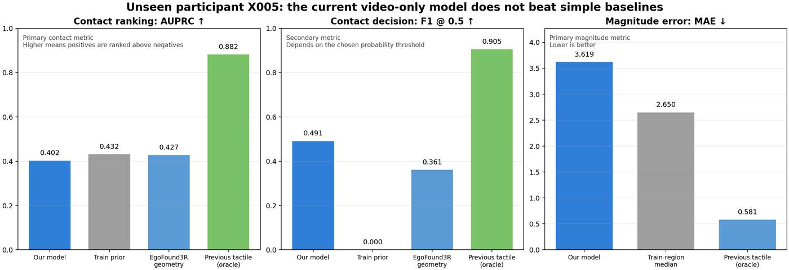
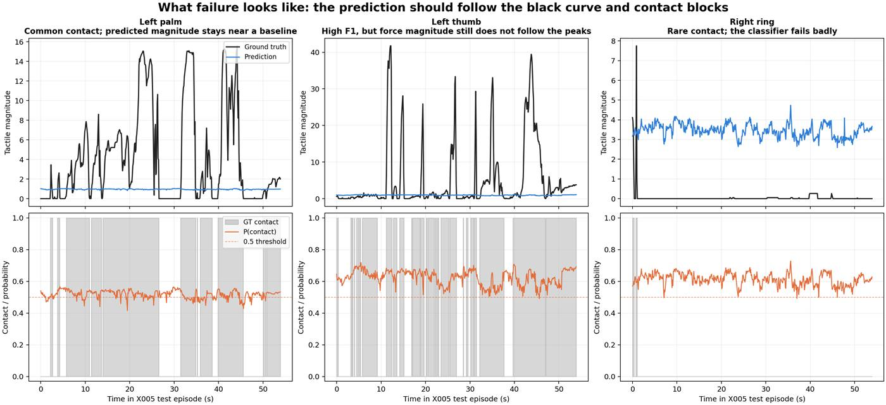

# 当前 Head-to-Tactile 基线、结果判断与 Wrist 创新方案

更新时间：2026-11-05

## 1. 核心结论

目前已经跑通的是一条完整的 **Head Ego Video → 12 区域触觉标签** 基线管线，但这条基线尚未使用项目的 wrist 创新点。

当前状态可以概括为：

> 数据读取、时间同步、特征提取、模型训练、跨参与者测试和可视化已经全部跑通；但当前模型在未见参与者上还没有超过简单基线，因此还不能用于给大规模网络视频可靠地生成触觉伪标签。

当前没有使用：

- 真实 wrist RGB；
- predicted wrist feature/view；
- wrist pose estimation；
- virtual wrist view synthesis；
- NVS 或 video generation。

因此，当前实验是后续 wrist 创新实验必须具备的 **Head-only 对照组 B0**。

---

## 2. 当前跑通的完整流程

```text
Head Ego RGB Video
        ↓
冻结的官方 EgoFound3R
        ↓
每只手 216 个语义点 × 768 维特征
        ↓
依据 MANO/LBS 权重映射到六个解剖区域
        ↓
每只手：palm/thumb/index/middle/ring/pinky
        ↓
16 帧因果时序网络
        ↓
双手共 12 区域：
① Contact Probability
② Tactile Magnitude
```

### 2.1 最终输入与输出

当前模型的最终推理输入只有：

```text
Head Ego RGB Video
```

最终输出为：

```text
左手：palm / thumb / index / middle / ring / pinky
右手：palm / thumb / index / middle / ring / pinky
```

每个区域输出：

```text
contact probability
tactile magnitude
```

因此接口层面已经满足最初目标：

\[
\text{只有 Head Ego Video}
\rightarrow
\text{自动生成 12 区域触觉标签}
\]

### 2.2 HumanTouch 标签处理

HumanTouch 原始触觉信号为 60 Hz。当前将其因果聚合为 10 Hz：

- 每六个触觉采样组成一个时间块；
- 触觉幅值取该时间块内有效采样的聚合值；
- 标签对应时间块最后一帧视频，避免使用该视频帧之后的触觉信息；
- 模型使用过去 16 个 10 Hz 时刻，即约 1.6 秒上下文。

由于压力手套存在预紧、褶皱、零漂和迟滞，不能直接使用 `magnitude > 0` 作为接触标签。当前采用：

```text
magnitude <= 0.1       → negative contact
0.1 < magnitude < 0.5 → ambiguous，分类损失中忽略
magnitude >= 0.5       → positive contact
```

连续强度使用 `log1p` 变换，并且只根据训练参与者统计区域级归一化参数。

### 2.3 当前训练了哪些部分

```text
EgoFound3R：冻结
12 区域时序触觉预测头：训练
```

这样首先回答：

> EgoFound3R 已有的 Head Ego 手部视觉特征，是否已经足以预测 HumanTouch 触觉？

### 2.4 数据切分

当前使用五名参与者，每人一个 episode：

| Split | Participant | 10 Hz frames | 16-frame windows |
|---|---|---:|---:|
| Train | X001、X002、X003 | 567 | 522 |
| Validation | X004 | 238 | 223 |
| Test | X005 | 555 | 540 |

不同 split 之间没有参与者重叠，窗口也不会跨 episode。这样测试的是跨参与者泛化，而不是记住相邻帧。

### 2.5 工程上已完成

- HumanTouch parquet 读取；
- Head RGB 与触觉时间同步；
- 60 Hz → 10 Hz 因果聚合；
- 有效标签和 ambiguous contact mask；
- EgoFound3R 中间手部特征提取；
- MANO 216 点到双手 12 区域映射；
- contact 分类和 magnitude 回归；
- participant-disjoint 切分；
- checkpoint 保存和双指标选模；
- AUPRC、F1、MAE、RMSE、Spearman 评估；
- 训练先验、EgoFound3R 几何接触和上一帧触觉参考；
- 时间曲线可视化；
- 仓库测试 39 项全部通过。

---

## 3. 如何判断结果好坏

不能使用训练 loss 是否下降作为最终判断。训练 loss 下降只能说明模型拟合了训练数据，不能说明它能处理未见参与者。

### 3.1 Contact 指标

#### AUPRC：主要指标，越高越好

AUPRC 衡量模型是否能把真实接触帧排在非接触帧之前。

之所以不把 Accuracy 作为主要指标，是因为接触类别严重不平衡。例如某个区域只有约 1% 的时间接触，始终预测“没有接触”也能获得约 99% Accuracy，但模型没有实际价值。

AUPRC：

- 综合 Precision 和 Recall；
- 不依赖某一个固定概率阈值；
- 更适合稀有接触事件；
- 应作为 contact prediction 的主要判断指标。

#### F1 @ 0.5：辅助指标，越高越好

F1 是 Precision 和 Recall 的调和平均值，但这里使用固定判断规则：

\[
P(\text{contact}) \ge 0.5
\]

因此 F1 会受到概率校准和阈值选择影响。模型如果长期输出 0.55，在高接触率区域也可能获得不错 F1，却不一定真正找准接触时刻。

### 3.2 Tactile Magnitude 指标

#### MAE：主要强度指标，越低越好

\[
\text{MAE}=\frac{1}{N}\sum_i|\hat{p}_i-p_i|
\]

它表示预测触觉强度平均偏离真值多少。

#### Spearman：曲线跟踪指标，越接近 1 越好

Spearman 衡量预测强度是否随着真实强度一起升高和降低：

- `1`：变化趋势完全一致；
- `0`：基本没有关系；
- `-1`：变化方向完全相反。

即使 MAE 不大，如果 Spearman 接近 0，也可能只是模型一直输出一个平均值。

#### 后续还需要 Onset/Offset Error

后续应增加接触开始和结束时刻误差，判断模型是否及时发现接触，而不只是总体分类正确。

---

## 4. 当前结果及其含义



### 4.1 X005 测试集总体结果

| Method | Contact AUPRC ↑ | F1 @ 0.5 ↑ | Magnitude MAE ↓ |
|---|---:|---:|---:|
| 当前模型，验证 MAE 选模 | 0.402 | 0.491 | 3.619 |
| 训练集区域先验 | 0.432 | 0.000 | 2.650 |
| EgoFound3R 几何接触 | 0.427 | 0.361 | 2.650* |
| 上一帧真实触觉参考 | 0.882 | 0.905 | 0.581 |

`*` EgoFound3R 几何接触没有物理触觉强度输出，因此 magnitude 使用与训练先验相同的固定区域中位数。

上一帧真实触觉使用了真实 tactile，并不是可部署的 video-only 模型，只用于说明标签具有很强时间连续性。

当前结果说明：

\[
0.402 < 0.432,\quad 0.402 < 0.427
\]

当前模型的 AUPRC 没有超过训练先验和 EgoFound3R 几何接触基线。

Magnitude 方面：

\[
3.619 > 2.650
\]

完全不看视频、只输出训练区域中位数，反而比当前模型更准确。

当前 X005 Spearman 为：

\[
\rho=-0.067
\]

它接近 0，说明预测强度变化几乎没有跟随真实强度变化。

### 4.2 代表区域时间曲线



图中：

- 黑线：真实 tactile magnitude；
- 蓝线：预测 tactile magnitude；
- 灰色区块：真实 contact；
- 橙线：预测 contact probability；
- 橙色虚线：0.5 分类阈值。

#### 左手掌

真实强度在 0–15 之间发生明显变化，但模型预测基本停留在 1 附近。模型只学到了一个平均基线，没有学到具体用力时刻和强度。

#### 左手拇指

该区域正样本很多，因此 F1 较高，但预测强度仍然没有跟随真实压力尖峰。这说明 F1 高不等于触觉强度预测准确。

#### 右手无名指

真实接触非常少，真实强度大部分时间接近 0，但模型持续预测约 3–4 的 magnitude，且接触概率长期高于 0.5，属于明显假阳性。

### 4.3 当前准确结论

| 问题 | 当前答案 |
|---|---|
| 数据、训练、评估管线是否跑通 | 是 |
| 模型是否能够拟合训练数据 | 是 |
| 是否能够跨参与者泛化 | 尚不能 |
| Contact AUPRC 是否超过简单基线 | 否 |
| Magnitude MAE 是否超过固定中位数基线 | 否 |
| 是否准确跟随真实触觉变化 | 否 |

所以应准确表述为：

> 第一版 Head Ego Video → 12 区域触觉标签 baseline 已完整跑通，但当前模型尚未学到可靠、可泛化的视觉—触觉对应关系。

---

## 5. 为什么当前阶段没有使用 Wrist

### 5.1 必须先建立 Head-only 对照组

项目创新目标是：

> 预测 wrist 视角或 wrist 表征，帮助 Head Ego Video 预测触觉。

因此必须先获得：

\[
\text{Head-only baseline}
\]

再和：

\[
\text{Head + Predicted Wrist}
\]

比较。否则即使后续结果提高，也无法判断提升究竟来自 wrist、更多参数、更复杂网络还是不同数据处理。

### 5.2 先隔离数据和标签问题

当前实验已经发现不同参与者的手套基线存在明显差异。例如：

- X004 右中指接触率约 96.6%；
- X005 左小指接触率约 88.5%；
- X005 右食指接触率约 3.1%。

如果第一版就加入 wrist，模型失败时无法区分究竟是 wrist 预测错误，还是手套标签和参与者 domain gap 导致。

### 5.3 当前 X002–X005 没有下载 Wrist RGB

为快速建立对照组，X002–X005 当前只下载了：

```text
Head RGB + tactile parquet
```

X001 有 wrist 视频，但单个参与者不足以训练和验证 wrist 模块。

### 5.4 真正 Wrist Camera Pose 缺少外参

HumanTouch 提供了 wrist tracker 6D pose，但没有公开：

\[
{}^{tracker}T_{wrist\ camera}
\]

因此目前可以获得 wrist device/tracker pose，但不能严谨地直接称为 wrist RGB optical camera pose。

这会阻塞：

```text
Wrist 6D Camera Pose
→ 3D重建/NVS
→ Virtual Wrist View
```

但不阻塞 synchronized wrist RGB teacher，因为特征蒸馏只需要时间同步，不一定需要光学外参。

---

## 6. 目前是否使用了 Wrist 创新点

没有。

当前模型为：

```text
Head Ego Video
      ↓
EgoFound3R Feature
      ↓
12-region Tactile Head
```

项目的目标创新模型应为：

```text
                    ┌→ Predicted Left Wrist Representation
Head Ego Video ─────┤
                    └→ Predicted Right Wrist Representation
                                  ↓
                     Head + Predicted Wrist Fusion
                                  ↓
                       12-region Tactile Tags
```

训练时允许使用真实 wrist RGB 监督 predicted wrist representation，但最终推理输入仍然只能是 Head Ego Video。

---

## 7. Wrist 创新点的正确实验分组

### B0：Head-only baseline

已经完成：

```text
Head RGB → EgoFound3R → Tactile Head
```

它是后续所有实验的对照组。

### B1：Real Wrist Oracle

训练和测试阶段暂时提供真实 wrist RGB：

```text
Head RGB + Real Left/Right Wrist RGB
                  ↓
             Tactile Model
```

这一组不满足最终部署要求，但可以回答：

> wrist 近距离视角本身是否真的能显著提高触觉预测？

如果 Real Wrist Oracle 都不能明显超过 B0，就没有必要继续研究 wrist prediction。

### B2：Predicted Wrist，最终创新组

训练阶段：

```text
真实 Wrist RGB
      ↓
Wrist Teacher Feature
      ↓ feature/logit distillation
Head Video → Predicted Wrist Feature
```

推理阶段：

```text
Head Video
      ↓
Predicted Wrist Feature
      ↓
Tactile Tags
```

最终推理不使用真实 wrist RGB。

---

## 8. Wrist Prediction 的三种路线

### 8.1 Wrist Feature Prediction：建议优先

```text
Head Ego Feature
      ↓
Wrist Feature Predictor
      ↓
Predicted Wrist Feature
      ↓
Tactile Head
```

真实 wrist RGB 通过 teacher encoder 得到监督特征。

优点：

- 不需要生成清晰 RGB；
- 不依赖 tracker→camera 外参；
- 计算量较低；
- 直接服务于 tactile prediction；
- 最容易做清晰的 B0/B1/B2 消融。

### 8.2 Wrist Pose Prediction

```text
Head Ego Video
      ↓
Left/Right Wrist 6D Camera Pose
      ↓
3D Scene + Rendering
      ↓
Virtual Wrist View
      ↓
Tactile Prediction
```

需要解决：

- wrist intrinsics；
- tracker→camera extrinsics；
- 可靠 3D 场景重建；
- 遮挡与动态物体；
- pose convention 和 metric scale。

### 8.3 Direct Wrist Video Generation

```text
Head Ego Video
      ↓
Video Generation
      ↓
Generated Left/Right Wrist Video
      ↓
Tactile Prediction
```

它不一定需要显式 pose，但训练成本最高，而且“图像看起来真实”不等于接触几何和触觉信息正确，因此不建议作为第一版。

---

## 9. 下一步执行计划

### 阶段一：扩大 Head + Wrist + Tactile 数据

建议下载：

```text
X001–X010
每人至少 3 个 episode

Head RGB
Left Wrist RGB
Right Wrist RGB
Tactile parquet
```

建议参与者级切分：

```text
X001–X007：train
X008：validation
X009–X010：test
```

### 阶段二：Contact-only Head baseline

当前 magnitude domain shift 较大，下一版先降低或关闭 magnitude loss，先解决：

```text
Head Ego Video → 12-region Contact Probability
```

通过条件：

\[
AUPRC_{Head-only}
>
AUPRC_{EgoFound3R\ geometry}
\]

并且提升必须在多个未见参与者上成立。

### 阶段三：Real Wrist Oracle

```text
Head RGB + Real Wrist RGB → Contact/Tactile
```

验证真实 wrist 是否提供增益：

\[
AUPRC_{Real\ Wrist} > AUPRC_{Head-only}
\]

\[
MAE_{Real\ Wrist} < MAE_{Head-only}
\]

### 阶段四：Wrist Feature Teacher–Student

使用真实 wrist RGB 作为训练 teacher，训练 Head-only student 预测 wrist feature。

最终比较：

| Model | Training input | Inference input | Purpose |
|---|---|---|---|
| B0 Head-only | Head + tactile | Head | 对照组 |
| B1 Real Wrist Oracle | Head + real wrist + tactile | Head + real wrist | Wrist 信息上限 |
| B2 Predicted Wrist | Head + real wrist teacher + tactile | Head only | 最终创新模型 |

### 阶段五：再研究 Wrist Pose/NVS

如果 predicted wrist feature 已经证明有效，再进一步研究：

```text
Head Video
→ Wrist 6D Pose
→ Virtual Wrist View
→ Tactile Prediction
```

此时需要先完成 tracker→camera 外参标定，并用 head 已知外参做 positive control。

---

## 10. 最终总结

当前完成的是：

> 不使用 wrist 的 Head-only 触觉预测 baseline，以及完整的数据、训练、评估和可视化管线。

当前尚未完成的是：

> 项目真正的创新模块——利用真实 wrist RGB 监督 Head Video 预测 wrist feature/view，并使用 predicted wrist representation 提高触觉标签质量。

接下来最合理的路线是：

```text
扩大多参与者数据
→ 先稳定 Head-only contact baseline
→ Real Wrist Oracle
→ Predicted Wrist Feature Teacher–Student
→ 最后再做 Wrist Pose / NVS
```

